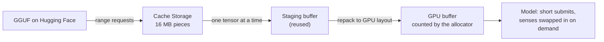

<h1 align="center">Tilde~Engine</h1>

<p align="center">A WebGPU engine that runs small language models in a browser tab, built to survive iPhone Safari.</p>

<p align="center"><a href="#quick-start">Quick start</a> · <a href="docs/design.md">Design doc</a> · <a href="bench/">Benchmarks and checks</a></p>

A phone's browser tab is a hostile place for a 1 GB model. iOS gives the whole tab about **1.9 GB**, shared by
JavaScript, WebAssembly and every GPU buffer, and kills it (Jetsam) the moment it goes over
([measured on an iPhone 16](https://github.com/KealJones/lm-experiments/blob/main/experiments/memcap/README.md); WebKit's engineers on
the OS limit: [bug 268816](https://bugs.webkit.org/show_bug.cgi?id=268816)). WebKit drops the GPU if one command buffer
runs past about **3 seconds** ([WebKit's watchdog](https://github.com/WebKit/WebKit/blob/main/Source/WebGPU/WebGPU/Queue.mm#L492-L494),
which logs "did not complete within 3s timeout"; the same crash in
[onnxruntime#33753](https://github.com/microsoft/onnxruntime/issues/33753)). Most browser runtimes hope to stay under
those lines. Tilde is built around them.

The `~` is for the limits it lives under, which only ever come approximately: ~1.9 GB, ~3 s.

## What it gets you

Measured on an iPhone 16 in Safari 27 with Liquid AI's LFM3 1.7B (QAD Q4_0), Nov 2026:

| | |
|---|---|
| Prompt reading | **51 tok/s** |
| Writing | **12.6 tok/s** |
| Memory the engine holds | **1,123 MB** at a 4K context, every byte counted |
| Reload from cache | **~5 s** |
| Matches llama.cpp | same top 5 and **12/12 identical greedy tokens** on the same prompt |

- **Never holds the whole file.** Weights arrive by HTTP range request, tensor by tensor, get repacked into the GPU
  layout in one small reused staging buffer, and are dropped. Peak memory while loading is the GPU weights so far plus
  one staging buffer, not the file twice.
- **Counts every byte.** All GPU memory goes through one allocator with a running total, so the engine can tell you
  what it holds and refuse a load that wouldn't fit instead of getting the tab killed.
- **Never trips the GPU watchdog.** Work is split into short submits sized ahead of time from per-batch-size
  measurements, so a long prompt never becomes one 4-second command buffer.
- **Swaps senses in and out.** With LFM3 Omni 2B the backbone stays resident and the vision encoder, audio encoder and
  speech generator each load when needed and free after. Peak is the backbone plus the largest sense (~1.3 GB of
  weights) instead of everything at once (~1.6 GB), which is what crashed Liquid's own WebGPU demo on an iPhone at
  ~80% loaded.
- **Sees, hears and speaks.** Pictures, video with its soundtrack, audio in, and the model's own voice out, all on
  the GPU. Vision on a 256×256 test image matches llama.cpp's first 8 greedy tokens.
- **Doesn't reread the conversation.** A new prompt that starts with what the model already read picks up where it
  left off, and snapshots let it reuse the prompt even when a chat template rewrites the last turn.
- **Downloads once.** Files are kept in Cache Storage in 16 MB pieces, resumable, so the second visit loads in
  seconds with no network.
- **Reads official GGUFs directly.** No conversion step and no extra hosting: point it at Liquid's file on Hugging
  Face.
- **No build step, no `shader-f16` required.** Plain ES modules with JSDoc types. Import it from jsDelivr or serve it
  from GitHub Pages as-is.



## Next to the other runtimes

The same LFM3 1.7B on the same iPhone 16 in Safari, Nov 2026. Details, sources and caveats are in
[docs/compared.md](docs/compared.md).

| Runtime | Result | Speed | How it ended |
|---|---|---|---|
| **Tilde** | ✅ runs | 51 tok/s reading, 12.6 writing | 1,123 MB at 4K, matches llama.cpp |
| **WebLLM** (our own MLC build) | ✅ with patches | 13.7 tok/s writing (before iOS 27.2.1) | Needs paced prefill since iOS 27.2.1; 8K killed the tab |
| **wllama 3.13** (llama.cpp, WebAssembly) | ❌ | – | Default build won't compile on iOS 27.2; forced Safari build got the tab killed |
| **transformers.js** (ONNX, WebGPU) | ❌ | – | Never finished downloading; 3 of 4 tries killed the tab |

Tilde isn't the fastest writer or the smallest in memory. It's the one that stays up on iOS 27 without patches,
needs no compile jobs, reads Liquid's official GGUFs as they are and swaps senses in and out.

## Quick start

```js
import { Tilde } from 'https://cdn.jsdelivr.net/gh/KealJones/tilde@a7234e4/src/index.js';

const llm = await Tilde.load(
  'https://huggingface.co/LiquidAI/LFM3-1.7B-GGUF/resolve/main/LFM3-1.7B-QAD-Q4_0.gguf',
  { onProgress: ({ loaded, total }) => console.log(`${Math.round((100 * loaded) / total)}%`) },
);

await llm.chat([{ role: 'user', content: 'Hi! Who are you?' }], {
  onToken: (t) => (out.textContent += t),
});

console.log(llm.stats()); // what the engine holds on the GPU
```

For the multimodal model, pass the encoder file as `mmproj`; each sense loads only when it's used:

```js
const omni = await Tilde.load(
  'https://huggingface.co/LiquidAI/LFM3-Omni-2B-GGUF/resolve/main/LFM3-Omni-2B-Q4_0.gguf',
  { mmproj: 'https://huggingface.co/LiquidAI/LFM3-Omni-2B-GGUF/resolve/main/mmproj-LFM3-Omni-2B-Q8_0.gguf' },
);

const bitmap = await createImageBitmap(file);
await omni.chat([{ role: 'user', content: [{ type: 'image', image: bitmap }, 'What is in this picture?'] }]);
const pcm = await omni.speak('Hello from inside a browser tab.'); // 24 kHz mono, streamed via onAudio
const words = await omni.transcribe(micPcm);                       // 16 kHz mono in
```

The [demo page](demo/index.html) does all of this with a model picker, photo and video input and a microphone
button. Run it locally with `node bench/server.mjs` and open `http://localhost:8790/demo/` (WebGPU needs localhost or
HTTPS).

## Models

- [LFM3 1.7B](https://huggingface.co/LiquidAI/LFM3-1.7B-GGUF) (Liquid AI): text, thinking, chat.
- [LFM3 Omni 2B](https://huggingface.co/LiquidAI/LFM3-Omni-2B-GGUF): text, pictures, video with its sound, audio in
  and its own voice out.

Model code lives in one file per architecture (`src/models/`), so adding another is a contained change.

## How it's checked

- `npm test`: GGUF parsing, quant repacking and the CPU reference math.
- `npm run gpu-test`: every kernel in headless Chrome on SwiftShader WebGPU, compared with the CPU reference and with
  llama.cpp's logits for the same tokens.
- Real iPhones, driven remotely through [phone-relay](https://github.com/KealJones/phone-relay), for load, memory and
  speed runs. The pages are in [`bench/`](bench/).

## Used by

[Squiggle](https://github.com/KealJones/squiggle), an AI agent that runs entirely in the browser, loads Tilde
straight from this repo, pinned by commit (landing in [squiggle#22](https://github.com/KealJones/squiggle/pull/22)).

## Status

Version 0.1.0 and moving fast. Next up: faster decode kernels (a decode step is now almost all GPU time, reading
weights at about 13 GB/s) and an English-only vocabulary trim that would take about 160 MB off the token table, adopted
only if it measures well. The [design doc](docs/design.md) has the full reasoning and every number above.

## License

MIT for the code. Model weights have their own licenses (LFM3: LFM Open License v1.0).
